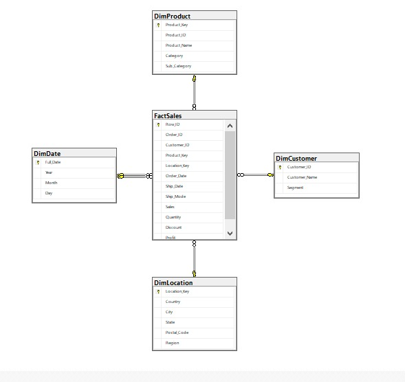

# Superstore SQL Business Intelligence

Retail analytics and dimensional data modeling using Microsoft SQL Server and T-SQL. The project focuses on the Central region of a sample Superstore dataset.

## Data and architecture

The source workbook contains 2,323 transaction rows (excluding the header). The star schema includes `FactSales` and four dimensions: `DimCustomer`, `DimProduct`, `DimLocation`, and `DimDate`. The fact table uses foreign keys for customer, product, location, order date and ship date.

## Business questions

- What are total sales and profit, and how do they vary by category and year?
- Which customers generate the most sales, orders and profit?
- How do discounts relate to profit?
- Which products generate profits or losses?
- How do monthly sales and state-level profit vary?

## SQL techniques

Joins, aggregations, CASE expressions, HAVING, nested subqueries, CTEs, views, a parameterized yearly KPI stored procedure, and indexes on fact-table columns. The repository includes 19 distinct analytical query files, the schema and population script, and separate reusable SQL objects.

## Run locally

1. Use Microsoft SQL Server and SQL Server Management Studio (SSMS).
2. Restore `Central_Superstore.bak` to a compatible SQL Server instance using SSMS (adjust destination file paths as required), and select the restored database before running queries 01–20. The backup contents and compatibility have not been independently tested.
3. Alternatively, import `Central_Superstore.xlsx` into a staging table named `Central_Superstore`. Map workbook headers to the underscore-separated SQL column names used in `00_star_schema.sql` (for example, `Row ID` to `Row_ID` and `Sub-Category` to `Sub_Category`). Verify date and numeric types and then run the schema script in an empty target database containing the staging table.
4. Run the analytical queries against the populated star schema. Apply indexes, views and procedure scripts only if the objects do not already exist. When creating views or procedures in SSMS, execute CREATE statements in separate batches from example SELECT/EXEC statements.

## Scope and limitations

This is a Central-region sample analysis, not a company-wide production warehouse. The scripts are the original project logic; they have not been executed again against SQL Server. Index performance gains are not benchmarked. The original fact-loading joins and grouping keys should be validated for unmatched rows and ambiguous names before production use. Source data redistribution rights and the backup contents have not been independently verified; review them before public upload.
